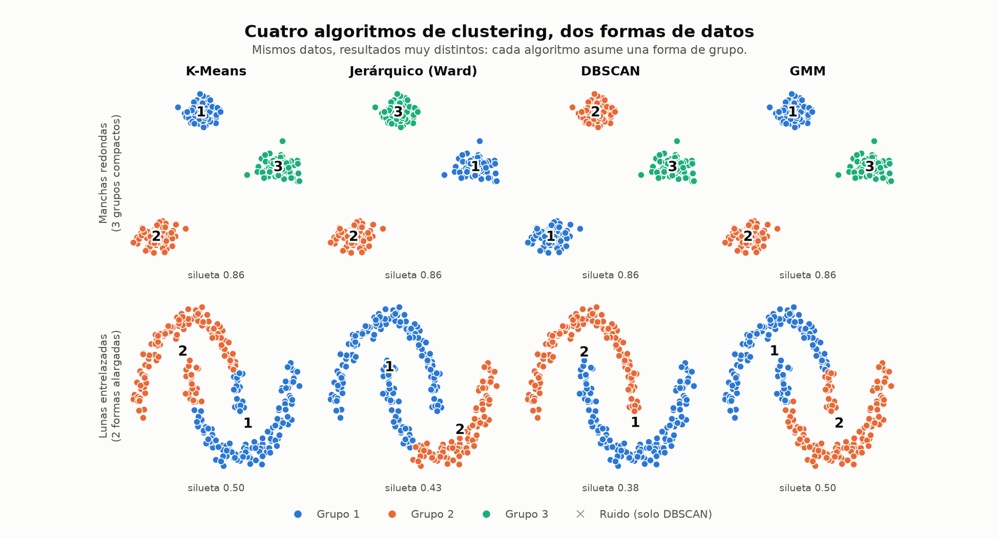
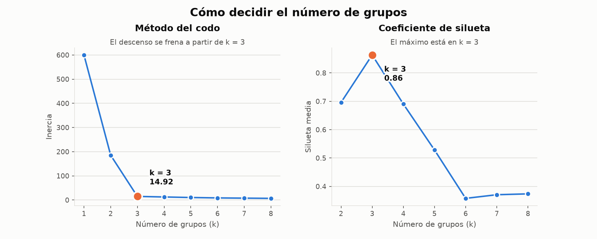
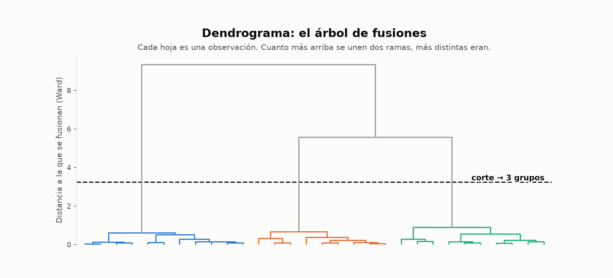

# Algoritmos de Clustering

> **Tarea de investigación — Módulo 2** · Bootcamp de IA
> Autora: [carovasq](https://github.com/carovasq)

Investigación sobre los algoritmos de clustering: cómo funcionan, sus principales
tipos, ventajas, desventajas y aplicaciones en el mundo real. El repositorio incluye
además una comparativa práctica ejecutada con `scikit-learn` sobre datasets de
juguete, para contrastar la teoría con resultados reales.

## Índice

1. [¿Qué es el aprendizaje no supervisado y qué es un algoritmo de clustering?](#1-qué-es-el-aprendizaje-no-supervisado-y-qué-es-un-algoritmo-de-clustering)
2. [Clustering por centroides vs. clustering jerárquico](#2-clustering-por-centroides-vs-clustering-jerárquico)
3. [Clustering basado en densidad: DBSCAN](#3-clustering-basado-en-densidad-dbscan)
4. [Elegir el número de clusters y evaluar la calidad del agrupamiento](#4-elegir-el-número-de-clusters-y-evaluar-la-calidad-del-agrupamiento)
5. [Los cuatro algoritmos en detalle](#5-los-cuatro-algoritmos-en-detalle)
6. [Comparativa práctica](#6-comparativa-práctica)
7. [Referencias](#7-referencias)

## Estructura del repositorio

```text
.
├── README.md          <- las respuestas a las 5 preguntas (la entrega)
├── docs/              <- enunciado original de la tarea
├── img/               <- gráficos generados por el script
└── src/               <- código de la comparativa práctica
```

---

## 1. ¿Qué es el aprendizaje no supervisado y qué es un algoritmo de clustering?

El **aprendizaje no supervisado** es la rama del *machine learning* que trabaja con
datos **sin etiquetar**: el conjunto de entrenamiento contiene únicamente las
variables de entrada (`X`), sin una respuesta correcta (`y`) asociada a cada
observación. El algoritmo no aprende a predecir un valor conocido, sino a
**descubrir la estructura que ya existe en los datos**.

Dentro de esta familia conviven varias tareas —reducción de dimensionalidad (PCA),
reglas de asociación, detección de anomalías, estimación de densidad— y entre ellas
la más representativa: el clustering.

### Qué es un algoritmo de clustering

Un **algoritmo de clustering** reparte las observaciones en grupos (*clusters*) de
forma que los elementos de un mismo grupo se parezcan mucho entre sí y se
diferencien de los de los demás grupos. Es la traducción algorítmica de una idea
muy intuitiva: *«junta lo que se parece, separa lo que no»*.

Ese «parecerse» no es una opinión, sino una **medida de distancia** calculada sobre
las variables:

- **Distancia euclídea**: la línea recta entre dos puntos. Es la opción por defecto
  y la que usan K-Means o DBSCAN.
- **Distancia de Manhattan**: la suma de las diferencias en cada variable; más
  robusta frente a valores extremos.
- **Similitud del coseno**: mide el ángulo en lugar de la separación; es la
  habitual con texto, donde importa la proporción de palabras y no su cantidad.

Como todas estas medidas suman magnitudes distintas, **escalar los datos
(estandarizarlos) antes de agrupar es prácticamente obligatorio**: si una variable
va en euros (0–50.000) y otra en años (18–80), la primera dominará la distancia y
el agrupamiento acabará reflejando solo el sueldo.

### Diferencias con el aprendizaje supervisado

| | Aprendizaje supervisado | Aprendizaje no supervisado |
|---|---|---|
| **Datos de entrada** | `X` + etiquetas `y` | solo `X` |
| **Objetivo** | predecir `y` para observaciones nuevas | descubrir la estructura oculta |
| **Quién define las categorías** | un humano, al etiquetar los datos | el propio algoritmo: son el resultado |
| **Ejemplo de tarea** | clasificar un correo como spam / no spam | segmentar clientes en perfiles de compra |
| **Cómo se evalúa** | comparando predicción y verdad conocida: *accuracy*, F1, RMSE | con métricas internas de cohesión y separación: silueta, inercia |
| **Coste de preparar los datos** | alto: etiquetar a mano es caro y lento | bajo: se aprovechan los datos tal y como están |
| **Algoritmos típicos** | regresión logística, árboles de decisión, SVM, redes neuronales | K-Means, clustering jerárquico, DBSCAN, GMM, PCA |

La diferencia de fondo es **quién define las categorías**. En el aprendizaje
supervisado vienen dadas de antemano por alguien que etiquetó los datos; en el no
supervisado **las categorías son el resultado, no el punto de partida**.

Entre ambos extremos existe el **aprendizaje semi-supervisado**, que combina unos
pocos datos etiquetados con una gran masa de datos sin etiquetar: el escenario más
frecuente en proyectos reales, donde etiquetar a mano resulta caro.

### Una consecuencia importante: no hay una única respuesta correcta

Al no existir una verdad de referencia, **ningún agrupamiento es «el correcto»**.
Los mismos clientes agrupados por edad producen unos grupos, y agrupados por gasto
mensual, otros completamente distintos; ambos resultados son matemáticamente
válidos. Por eso el resultado de un clustering no es una conclusión cerrada sino
**una hipótesis que debe validarse con conocimiento del dominio**, y por eso las
métricas de calidad (ver [pregunta 4](#4-elegir-el-número-de-clusters-y-evaluar-la-calidad-del-agrupamiento))
miden la *forma* de los grupos y no su *acierto*.

### Propósito y aplicaciones reales

- **Explorar** un dataset del que aún no se sabe nada y obtener una primera
  descripción de su estructura.
- **Segmentar clientes** para campañas de marketing diferenciadas (el clásico
  análisis RFM: recencia, frecuencia e importe de compra).
- **Detectar anomalías**: lo que no encaja en ningún grupo suele ser lo valioso
  —fraude con tarjetas, intrusiones en una red, fallos en una cadena de montaje—.
- **Agrupar documentos o noticias** por tema sin haber definido antes las categorías.
- **Comprimir información**: reducir los millones de colores de una imagen a los 16
  más representativos, o resumir miles de observaciones en unos pocos perfiles.
- **Investigación biomédica**: identificar tipos celulares o subtipos de una
  enfermedad a partir de datos de expresión génica.
- **Preparar el terreno para un modelo supervisado**: el cluster asignado puede
  usarse como una variable adicional, o servir de guía para etiquetar a mano solo
  una muestra representativa.

## 2. Clustering por centroides vs. clustering jerárquico

Ambos enfoques persiguen lo mismo —agrupar lo parecido— pero parten de ideas
opuestas sobre **qué es un agrupamiento**: para el particional es un *reparto*;
para el jerárquico, una *jerarquía de parentescos*.

### El enfoque particional o basado en centroides

Divide el conjunto de datos en **k grupos planos, disjuntos y al mismo nivel**: cada
observación pertenece a uno y solo uno, y no hay relación de pertenencia entre
grupos. El número de grupos **se fija antes de empezar**, y cada grupo queda
representado por un **prototipo**: el centroide, es decir, el punto promedio de
todos sus miembros (que normalmente no coincide con ninguna observación real).

**Algoritmo representativo: K-Means.** Funciona por refinamiento iterativo:

1. Se eligen k centroides iniciales (al azar, o mejor con la estrategia *k-means++*).
2. **Asignación**: cada punto se adjudica al centroide más cercano.
3. **Actualización**: cada centroide se recalcula como la media de los puntos que le
   han correspondido.
4. Se repiten 2 y 3 hasta que las asignaciones dejan de cambiar.

Lo que K-Means minimiza en ese proceso es la **inercia** o suma de cuadrados
intra-cluster (*WCSS*): la suma de las distancias al cuadrado de cada punto a su
centroide.

```text
WCSS = Σ        Σ        ‖ x − μᵢ ‖²
      i=1..k   x ∈ Cᵢ
```

Es un procedimiento **voraz y no determinista**: converge a un mínimo local que
depende de dónde cayeron los centroides iniciales, razón por la cual en la práctica
se ejecuta varias veces (`n_init`) y se conserva la mejor solución.

### El enfoque jerárquico

No produce *una* partición, sino **una jerarquía anidada de particiones**: una
estructura de árbol en la que cada grupo contiene subgrupos, y estos a su vez otros.
**No exige fijar k de antemano**; el número de grupos se decide al final, cortando
el árbol a la altura que interese.

Existen dos estrategias:

- **Aglomerativa (*bottom-up*)**, la habitual: se parte de n grupos de un solo
  elemento y en cada paso se fusionan los dos grupos más próximos, hasta que todo
  queda reunido en uno.
- **Divisiva (*top-down*)**: se parte de un único grupo con todo y se va dividiendo.
  Es mucho más costosa y apenas se usa.

**Algoritmo representativo: Clustering Jerárquico Aglomerativo.** Su parámetro clave
no es k, sino el **criterio de enlace** (*linkage*), que define la distancia entre
dos *grupos* a partir de las distancias entre sus puntos:

| Criterio | Distancia entre dos grupos | Efecto |
|---|---|---|
| **Simple** (*single*) | la de sus dos puntos más cercanos | detecta formas alargadas e irregulares, pero sufre el *efecto cadena*: grupos distintos unidos por un hilo de puntos acaban fusionados |
| **Completo** (*complete*) | la de sus dos puntos más lejanos | produce grupos compactos y de tamaño similar; sensible a valores atípicos |
| **Promedio** (*average*) | la media de todas las distancias entre pares | solución intermedia y estable |
| **Ward** | el incremento de varianza interna que provoca la fusión | el más usado; tiende a grupos esféricos y equilibrados, muy parecidos a los de K-Means |

### El dendrograma

El resultado se representa en un **dendrograma**, un árbol que se lee de abajo
arriba. La **altura** a la que dos ramas se unen indica la distancia a la que se
produjo esa fusión: cuanto más arriba, más diferentes eran los grupos fusionados.

```text
 distancia
     │
   8 ┤  ┌───────────────────────────┐
     │  │                           │
   5 ┤  │             ┌─────────────┴─────────────┐
     │  │             │                           │
 - - │- │- - - - - - -│- - - - - - - - - - - - - -│- - -   corte → 3 grupos
   2 ┤  │       ┌─────┴─────┐               ┌─────┴─────┐
     │  │       │           │               │           │
   0 ┴──E───────A───────────B───────────────C───────────D
```

**El número de grupos se elige cortando el árbol con una línea horizontal**: tantas
ramas atraviese el corte, tantos grupos resultan. En el ejemplo, el corte produce
`{A,B}`, `{C,D}` y `{E}`; un corte más bajo daría cuatro o cinco grupos, y uno más
alto, dos. Un salto vertical grande entre dos fusiones —como el que hay entre la
altura 5 y la 8— es señal de que ahí había una separación real en los datos, y
sugiere un buen punto de corte.

### Comparativa directa

| | Particional / centroides (K-Means) | Jerárquico (aglomerativo) |
|---|---|---|
| **Resultado** | una partición plana en k grupos | un árbol de particiones anidadas |
| **¿Hay que fijar k?** | sí, antes de ejecutar | no, se decide después al cortar |
| **Cómo representa un grupo** | por su centroide (punto promedio) | por el historial de fusiones |
| **Parámetro crítico** | k y la inicialización | el criterio de enlace y la altura de corte |
| **Determinismo** | no: depende de los centroides iniciales | sí: mismos datos, mismo árbol |
| **¿Se puede corregir un error?** | sí, un punto puede cambiar de grupo en la siguiente iteración | no: una fusión es irreversible |
| **Coste computacional** | ≈ O(n·k·i·d), lineal en el nº de datos | ≈ O(n²) de memoria y hasta O(n³) de tiempo |
| **Escala a** | millones de observaciones | unos pocos miles |
| **Visualización propia** | mapa de puntos y centroides | dendrograma |

### Cuándo usar cada uno

- **K-Means** cuando el conjunto es grande, las variables son numéricas, se espera
  que los grupos sean compactos y aproximadamente esféricos, y existe una idea
  razonable del valor de k.
- **Jerárquico** cuando el conjunto es manejable, no se sabe cuántos grupos hay, o
  cuando la propia estructura anidada es informativa —taxonomías biológicas,
  organización de documentos, análisis exploratorio—. El dendrograma es, además, una
  herramienta de comunicación excelente ante alguien que no es técnico.

> **Lo que ambos comparten** es también su límite común: los dos tienden a producir
> grupos de forma convexa y a repartir *todas* las observaciones, sin reconocer que
> algunas puedan ser simple ruido. De ahí nace el enfoque de la pregunta siguiente.

## 3. Clustering basado en densidad: DBSCAN

El clustering basado en densidad parte de una definición de grupo radicalmente
distinta: **un cluster es una región del espacio densamente poblada de
observaciones, delimitada por regiones de baja densidad**. No importa la distancia a
un centro, sino cuántos vecinos próximos tiene cada punto.

**DBSCAN** (*Density-Based Spatial Clustering of Applications with Noise*, 1996) es
su algoritmo de referencia.

### Los dos hiperparámetros

| Parámetro | Qué define |
|---|---|
| **`eps` (ε)** | el radio del vecindario: a qué distancia máxima dos puntos se consideran vecinos |
| **`min_samples`** (*MinPts*) | cuántos puntos debe haber dentro de ese radio para que la zona se considere densa |

### Los tres tipos de punto

A partir de esos dos valores, cada observación se clasifica como:

- **Punto núcleo** (*core*): tiene al menos `min_samples` puntos dentro de su radio
  `eps`. Está en el interior denso de un grupo.
- **Punto frontera** (*border*): no alcanza ese mínimo, pero cae dentro del radio de
  un punto núcleo. Está en el borde del grupo.
- **Ruido** (*noise*): ni una cosa ni la otra. **No se asigna a ningún cluster** y
  `scikit-learn` lo etiqueta con `-1`.

```text
                    ● ● ●
                  ● ◉ ◉ ● ●          ◉  núcleo    ≥ min_samples vecinos dentro de ε
     ✕          ● ◉ ◉ ◉ ◉ ●          ●  frontera  pocos vecinos, pero toca un núcleo
   ruido          ● ◉ ◉ ● ●          ✕  ruido     ni lo uno ni lo otro
                    ● ● ●
```

### Mecanismo

1. Se toma un punto no visitado y se cuentan sus vecinos dentro del radio `eps`.
2. Si no llega a `min_samples`, se marca provisionalmente como **ruido** (puede
   rescatarse más tarde si resulta ser frontera de otro grupo).
3. Si lo alcanza, es un **punto núcleo** y se abre un cluster nuevo con él.
4. El cluster **se expande por contagio**: se incorporan sus vecinos, y si alguno de
   ellos es también núcleo, se incorporan además los vecinos de este, y así
   sucesivamente. Es la propiedad de *alcanzabilidad por densidad*, y es la que
   permite que un grupo se extienda siguiendo una forma curva o alargada.
5. Cuando la expansión se agota, se pasa al siguiente punto sin visitar.

El número de grupos **no se decide: emerge** de la estructura de densidad de los
datos.

### En qué se diferencia de los otros dos enfoques

| | Centroides (K-Means) | Jerárquico | Densidad (DBSCAN) |
|---|---|---|---|
| **Qué es un grupo** | puntos cercanos a un centro | puntos fusionados pronto en el árbol | región densa rodeada de vacío |
| **Nº de grupos** | se fija antes (`k`) | se elige después, cortando | **lo decide el algoritmo** |
| **Forma detectable** | convexa, tendente a esférica | depende del enlace; con Ward, esférica | **cualquiera**: curvas, anillos, eses |
| **Grupos de distinto tamaño** | los iguala en extensión | tolerable | sin problema |
| **Valores atípicos** | se asignan a la fuerza y **desplazan el centroide** | se asignan a la fuerza | **se aíslan como ruido** |
| **Parámetros críticos** | `k`, inicialización | criterio de enlace, altura de corte | `eps`, `min_samples` |
| **Determinismo** | no | sí | casi: solo los puntos frontera pueden variar según el orden de recorrido |
| **Coste** | O(n·k·i·d) | hasta O(n³) | O(n log n) con indexación espacial; O(n²) sin ella |

Las tres diferencias de fondo:

1. **No hay que decir cuántos grupos hay.** K-Means lo exige y el jerárquico lo
   pospone; DBSCAN lo deduce.
2. **No asume ninguna forma.** K-Means solo puede trazar fronteras rectas alrededor
   de centros, de modo que únicamente encuentra grupos convexos. DBSCAN sigue la
   forma que dibujen los propios datos.
3. **Incorpora el concepto de ruido.** Es el único de los tres que puede responder
   *«esta observación no pertenece a ningún grupo»*, lo que lo convierte además en
   un detector de anomalías.

### Cómo se eligen `eps` y `min_samples`

- **`min_samples`**: como regla práctica, al menos *número de variables + 1*, y
  habitualmente el doble del número de variables. Valores altos producen grupos más
  robustos y más ruido.
- **`eps`**: mediante el **gráfico de k-distancias**. Se calcula para cada punto la
  distancia a su k-ésimo vecino más próximo (con *k* = `min_samples`), se ordenan de
  menor a mayor y se representan. La curva resultante presenta un codo: el valor de
  `eps` adecuado es la altura de ese codo, el punto donde las distancias empiezan a
  dispararse porque ya se está midiendo hacia zonas vacías.

Como DBSCAN trabaja con distancias absolutas, **escalar las variables antes de
ejecutarlo no es opcional**.

### Ventajas y limitaciones

**A favor:** no requiere fijar el número de grupos; detecta formas arbitrarias;
identifica valores atípicos en lugar de dejarse arrastrar por ellos; es robusto y
eficiente con indexación espacial.

**En contra:**

- **Es muy sensible a `eps`**: una variación pequeña puede fundir dos grupos en uno
  o pulverizar uno en muchos.
- **Falla con densidades heterogéneas.** Un único `eps` no puede servir a la vez
  para un grupo compacto y otro disperso: o se fragmenta el disperso, o se fusiona
  el compacto con su entorno. Es su punto débil más conocido, y lo que motivó
  **OPTICS** y **HDBSCAN**, que manejan densidades variables.
- **Sufre la maldición de la dimensionalidad**: en espacios de muchas variables las
  distancias tienden a igualarse y la noción de vecindario pierde sentido. Conviene
  reducir la dimensionalidad (PCA) antes de aplicarlo.
- **Los puntos frontera son ambiguos**: si uno cae en el radio de dos grupos
  distintos, acaba en el que lo alcance primero.

En la [comparativa práctica](#6-comparativa-práctica) de este repositorio se observa
el efecto con claridad: sobre un conjunto con forma de dos medias lunas entrelazadas,
DBSCAN es el único de los cuatro algoritmos que recupera exactamente los grupos
reales.

## 4. Elegir el número de clusters y evaluar la calidad del agrupamiento

### Por qué es crítico acertar

El riesgo no es que el algoritmo falle: es que **nunca avisa**. Un algoritmo de
clustering siempre devuelve un resultado, y lo devuelve con el mismo aplomo tanto si
los grupos que ha encontrado son reales como si los ha inventado. Pedirle a K-Means
siete grupos sobre unos datos que solo tienen tres produce siete grupos de aspecto
perfectamente convincente.

Las consecuencias de errar son asimétricas y ambas caras:

- **Un `k` demasiado pequeño** funde segmentos que se comportan de forma distinta:
  los perfiles se promedian entre sí y las conclusiones se diluyen en una media que
  no describe a nadie.
- **Un `k` demasiado grande** fragmenta un grupo real en subgrupos artificiales;
  se acaban describiendo diferencias que son puro azar muestral.
- **En DBSCAN** el problema se traslada a `eps`: un valor pequeño convierte casi
  todo en ruido, y uno grande funde el conjunto entero en un único cluster.

Y como esto no es un ejercicio abstracto, el error se traduce en decisiones: una
segmentación de clientes mal calibrada significa campañas dirigidas a perfiles que
no existen.

### El problema de fondo

Al no existir etiquetas verdaderas, **no se puede medir el acierto**. No hay un
*accuracy* que calcular. Lo único observable es la **geometría del resultado**:
cómo de compactos son los grupos por dentro y cómo de separados están entre sí. Toda
la familia de métricas internas se construye sobre esas dos ideas: **cohesión** y
**separación**.

### Método 1: el método del codo (*elbow method*)

Se ejecuta el algoritmo para un rango de valores de `k` y se representa la
**inercia** (la suma de distancias al cuadrado de cada punto a su centroide) frente
a `k`.

La inercia **siempre disminuye** al aumentar `k` —con `k` igual al número de
observaciones valdría cero, un grupo por punto—, así que no sirve buscar su mínimo.
Lo que se busca es el **codo**: el punto a partir del cual la curva se aplana porque
añadir grupos ya no mejora apenas nada. Ese codo marca el equilibrio entre un modelo
simple y un modelo que explica bien los datos.

Resultados reales sobre el conjunto de tres manchas de la comparativa de este
repositorio:

| k | Inercia | Reducción respecto al anterior | Silueta media |
|---:|---:|---:|---:|
| 1 | 600,0 | — | n/d |
| 2 | 185,2 | 69,1 % | 0,696 |
| **3** | **14,9** | **91,9 %** | **0,863** |
| 4 | 12,6 | 15,4 % | 0,690 |
| 5 | 10,4 | 17,8 % | 0,528 |
| 6 | 8,7 | 15,9 % | 0,358 |

El codo es inequívoco: pasar de 2 a 3 grupos reduce la inercia un **91,9 %**,
mientras que pasar de 3 a 4 apenas la reduce un **15,4 %**. A partir de ahí la curva
se aplana. La respuesta es `k = 3`, que es justamente el número de grupos con que se
generaron los datos.

**Limitación:** el codo solo resulta tan evidente cuando los grupos están bien
separados. Con datos reales la curva suele descender de forma suave y la
identificación del codo se vuelve subjetiva —de ahí que exista el **estadístico gap**
(*gap statistic*), que automatiza la decisión comparando la inercia obtenida con la
de datos aleatorios sin estructura—.

### Método 2: el coeficiente de silueta (*silhouette coefficient*)

Es una medida más informativa, porque evalúa **cada observación por separado**. Para
un punto *i*:

- **a(i)** = distancia media a los demás puntos **de su propio grupo** → cohesión.
- **b(i)** = distancia media a los puntos **del grupo vecino más próximo** →
  separación.

```text
         b(i) − a(i)
 s(i) = ───────────────
        max( a(i), b(i) )
```

El valor resultante se mueve entre **−1 y 1**:

| s(i) | Interpretación |
|---|---|
| cercano a **1** | el punto está mucho más cerca de los suyos que del grupo vecino: bien asignado |
| cercano a **0** | está justo en la frontera entre dos grupos: asignación dudosa |
| **negativo** | está más cerca del grupo vecino que del propio: **probablemente mal asignado** |

La **silueta media** de todas las observaciones resume la calidad del agrupamiento, y
se escoge el `k` que la maximiza. Como referencia orientativa: por encima de 0,7 la
estructura es fuerte; entre 0,5 y 0,7, razonable; entre 0,25 y 0,5, débil; por debajo
de 0,25 no hay estructura apreciable.

En la tabla anterior la silueta alcanza su máximo en **k = 3 (0,863)** y cae de
inmediato al añadir un cuarto grupo (0,690). **Ambos métodos coinciden**, que es la
situación ideal: cuando el codo y la silueta señalan el mismo valor, la confianza en
la elección es alta.

Su ventaja añadida es el **diagrama de silueta**, que representa el valor de cada
punto agrupado por cluster. Permite detectar lo que una media esconde: un grupo con
muchos valores negativos, o uno desproporcionadamente pequeño, son señales de que ese
`k` no es el adecuado aunque el promedio parezca aceptable.

### Otras métricas habituales

| Métrica | Idea | Criterio |
|---|---|---|
| **Davies-Bouldin** | razón entre dispersión interna y separación entre grupos | cuanto **menor**, mejor |
| **Calinski-Harabasz** | razón entre varianza inter-grupo e intra-grupo | cuanto **mayor**, mejor |
| **BIC / AIC** | verosimilitud penalizada por complejidad | específicas de GMM; cuanto **menor**, mejor |
| **Gráfico de k-distancias** | distancia al k-ésimo vecino, ordenada | para fijar `eps` en DBSCAN |

### La advertencia importante: las métricas internas tienen sesgo de forma

Codo y silueta se calculan a partir de distancias a centros y entre grupos, de modo
que **premian implícitamente los grupos compactos y esféricos**. Cuando los grupos
reales tienen otra forma, la métrica engaña. Resultados medidos sobre el conjunto de
dos medias lunas entrelazadas de este repositorio:

| Algoritmo | Acierto real (ARI) | Silueta media |
|---|---:|---:|
| K-Means | 0,48 | **0,50** |
| Jerárquico (Ward) | 0,43 | 0,43 |
| **DBSCAN** | **1,00** | 0,38 |
| GMM | 0,49 | **0,50** |

**DBSCAN recupera los grupos verdaderos con exactitud perfecta y, sin embargo,
obtiene la peor silueta de los cuatro.** La métrica no mide si el agrupamiento es
correcto —no puede saberlo—, mide si *parece* un agrupamiento clásico de grupos
redondos. El ARI de la primera columna solo puede calcularse aquí porque son datos
sintéticos de los que conocemos la verdad; en un caso real esa columna no existiría.

La conclusión práctica: **las métricas internas orientan, no deciden**. Un buen
procedimiento combina varias de ellas, las contrasta con la visualización de los
datos y, sobre todo, somete el resultado a la prueba definitiva: **¿los grupos
obtenidos significan algo para quien conoce el negocio?** Un agrupamiento con una
silueta mediocre pero que identifica segmentos de cliente accionables vale más que
uno con silueta excelente del que nadie sabe qué decir.

## 5. Los cuatro algoritmos en detalle

### 5.1 · K-Means

`sklearn.cluster.KMeans`

**Mecanismo.** Se fija de antemano el número de grupos `k`. El algoritmo sitúa `k`
centroides iniciales (idealmente con *k-means++*, que los reparte alejados entre sí)
y alterna dos operaciones hasta la convergencia: **asignar** cada punto al centroide
más cercano y **recalcular** cada centroide como la media de los puntos asignados.
El objetivo que minimiza es la inercia, la suma de distancias al cuadrado de cada
punto a su centroide.

**Ventajas**

- Muy rápido y de complejidad lineal en el número de observaciones: escala a
  millones de registros, y existe la variante *MiniBatchKMeans* para datos masivos.
- Sencillo de entender, implementar y explicar a un público no técnico.
- Los centroides son interpretables: cada uno es el «perfil medio» de su grupo.

**Desventajas**

- Exige decidir `k` antes de ejecutar.
- No es determinista: el resultado depende de la inicialización, por lo que debe
  repetirse varias veces (`n_init`).
- Solo encuentra grupos **convexos y de tamaño similar**; fracasa con formas
  alargadas o anidadas.
- Muy sensible a valores atípicos, porque la media se desplaza hacia ellos. La
  variante **K-Medoids** usa puntos reales en lugar de medias y es más robusta.
- Requiere variables numéricas y escaladas.

**Casos de uso.** Segmentación de clientes y análisis RFM; compresión de imágenes
por cuantización de color; agrupación de documentos vectorizados; detección de
patrones de consumo; preprocesado para reducir un conjunto grande a unos pocos
prototipos.

---

### 5.2 · Clustering Jerárquico Aglomerativo

`sklearn.cluster.AgglomerativeClustering` · dendrograma con `scipy.cluster.hierarchy`

**Mecanismo.** Comienza con tantos grupos como observaciones y, en cada paso,
fusiona los dos más próximos según un **criterio de enlace** (simple, completo,
promedio o Ward), hasta reunirlo todo en un único grupo. El recorrido completo se
representa en un **dendrograma**, y el número final de grupos se obtiene cortándolo
a la altura deseada.

**Ventajas**

- No requiere fijar el número de grupos de antemano: se decide después, a la vista
  del árbol.
- Es determinista: los mismos datos producen siempre el mismo dendrograma.
- El dendrograma aporta información sobre la **estructura anidada** —subgrupos
  dentro de grupos— que ningún otro método ofrece, y es una herramienta de
  comunicación muy eficaz.
- Admite cualquier métrica de distancia, incluso datos no vectoriales para los que
  solo se dispone de una matriz de distancias.

**Desventajas**

- Coste elevado: del orden de O(n²) en memoria y hasta O(n³) en tiempo, lo que lo
  limita a unos pocos miles de observaciones.
- **Las fusiones son irreversibles**: un error temprano se arrastra hasta el final.
- El resultado cambia sustancialmente con el criterio de enlace elegido.
- El enlace simple sufre el *efecto cadena*: dos grupos distintos unidos por un hilo
  de puntos intermedios acaban fusionados.

**Casos de uso.** Taxonomías biológicas y filogenética; análisis exploratorio cuando
se desconoce el número de grupos; organización jerárquica de documentos; estudios de
mercado con muestras reducidas; cualquier dominio en que la jerarquía sea en sí misma
el objeto de interés.

---

### 5.3 · DBSCAN

`sklearn.cluster.DBSCAN` · variante moderna: `sklearn.cluster.HDBSCAN`

**Mecanismo.** Define los grupos como regiones densas. Con dos parámetros —`eps`, el
radio del vecindario, y `min_samples`, el mínimo de vecinos para considerarlo denso—
clasifica cada punto como **núcleo**, **frontera** o **ruido**, y hace crecer cada
cluster propagándose de punto núcleo en punto núcleo mientras haya densidad
suficiente. El número de grupos no se indica: resulta del proceso.

**Ventajas**

- No necesita que se especifique el número de grupos.
- Detecta grupos de **forma arbitraria**: curvas, anillos, espirales.
- **Identifica el ruido** en lugar de repartirlo por la fuerza, lo que lo convierte
  también en detector de anomalías.
- Robusto frente a valores atípicos, que no distorsionan los grupos.
- Eficiente —O(n log n)— cuando se apoya en estructuras de indexación espacial.

**Desventajas**

- Muy sensible a `eps`: variaciones pequeñas alteran el resultado por completo.
- **No maneja densidades heterogéneas**: un único radio no puede servir a un grupo
  compacto y a otro disperso a la vez. Lo resuelven **OPTICS** y **HDBSCAN**.
- Se degrada en espacios de alta dimensión, donde las distancias se homogeneizan.
- Los puntos frontera son ambiguos si están al alcance de dos grupos.
- Sus métricas internas de calidad (silueta) tienden a penalizarlo precisamente por
  encontrar formas no esféricas.

**Casos de uso.** Detección de fraude e intrusiones; análisis de datos espaciales y
GPS —identificar zonas de concentración de actividad—; segmentación de imágenes;
limpieza de datos previa a otro modelo; agrupación de eventos sísmicos o de
incidencias.

---

### 5.4 · Gaussian Mixture Models (GMM)

`sklearn.mixture.GaussianMixture`

**Mecanismo.** Supone que los datos proceden de la mezcla de `k` **distribuciones
normales (gaussianas)**, cada una con su media, su matriz de covarianza y su peso.
Los parámetros se estiman con el algoritmo **EM** (*Expectation-Maximization*), que
alterna dos pasos: **E**, calcular con qué probabilidad pertenece cada punto a cada
componente, y **M**, reestimar medias, covarianzas y pesos a partir de esas
probabilidades. El resultado no es una etiqueta, sino un **vector de probabilidades**
por observación: es *clustering blando*.

**Ventajas**

- **Asignación probabilística**: en lugar de forzar una pertenencia, cuantifica la
  incertidumbre, lo que resulta valioso cuando los grupos se solapan.
- Los grupos pueden ser **elipses** de distinto tamaño, orientación y proporción,
  no solo círculos; se ajusta a estructuras que K-Means parte mal.
- Es un **modelo generativo**: permite calcular la verosimilitud de una observación
  nueva y, por tanto, detectar anomalías, o generar datos sintéticos.
- Dispone de criterios objetivos para elegir `k`: **BIC** y **AIC**.
- **K-Means es un caso particular suyo**, el correspondiente a covarianzas esféricas
  idénticas y asignación dura.

**Desventajas**

- Asume que los grupos son gaussianos; si la distribución real es muy distinta, el
  ajuste es pobre.
- Sigue exigiendo fijar `k`.
- EM converge a un **óptimo local** y depende de la inicialización.
- Estima muchos más parámetros que K-Means, de modo que necesita más datos y resulta
  más lento.
- Puede degenerar si una componente colapsa sobre unos pocos puntos (covarianza
  singular); se controla con el parámetro de regularización `reg_covar`.

**Casos de uso.** Reconocimiento de voz y de locutor —fue el modelo dominante
durante décadas—; modelado de rendimientos financieros; segmentación de imágenes;
detección de anomalías mediante umbral de verosimilitud; segmentación de clientes
cuando los perfiles se solapan y conviene conservar la ambigüedad; estimación de
densidad en general.

---

### Cómo elegir entre los cuatro

| Situación | Algoritmo recomendado |
|---|---|
| Muchos datos, grupos compactos, `k` conocido o estimable | **K-Means** |
| Pocos datos, `k` desconocido, interesa la estructura anidada | **Jerárquico** |
| Formas irregulares, presencia de valores atípicos, `k` desconocido | **DBSCAN** |
| Grupos solapados o elípticos, se desea una medida de incertidumbre | **GMM** |

En la práctica rara vez se elige uno a ciegas: lo razonable es **ejecutar varios,
comparar sus métricas y visualizar los resultados** antes de decidir, que es
exactamente lo que hace la comparativa de la sección siguiente.

## 6. Comparativa práctica

Todas las cifras citadas en las respuestas anteriores proceden de este experimento,
y puede reproducirse por completo:

```bash
pip install -r requirements.txt
python src/comparativa_clustering.py
```

El script genera las tres figuras de esta sección e imprime las tablas de métricas.
La semilla aleatoria está fijada (`random_state=42`), de modo que los resultados son
idénticos en cada ejecución.

**Los datos** son dos conjuntos sintéticos de 300 observaciones y dos variables,
elegidos por tener formas opuestas: tres **manchas redondas** bien separadas y dos
**medias lunas entrelazadas**. Ambos se estandarizan antes de agrupar.

### Los cuatro algoritmos sobre las dos formas



**Fila superior — las manchas redondas.** Los cuatro algoritmos devuelven
**exactamente la misma partición**: la coincidencia entre cada par de ellos es de
1,00, y DBSCAN no marca ni un solo punto como ruido. Cuando los grupos son compactos,
están separados y tienen tamaños parecidos, la elección del algoritmo es
intrascendente: todos encuentran lo mismo y lo sensato es quedarse con el más rápido
y simple, que es K-Means.

**Fila inferior — las lunas entrelazadas.** Aquí se separan las filosofías. K-Means,
el jerárquico y GMM trazan una frontera que **corta las dos lunas por la mitad**:
ninguno de los tres puede hacerlo mejor, porque los tres buscan grupos convexos y una
media luna no lo es. DBSCAN, que solo sigue el rastro de la densidad, recupera las
dos lunas **exactamente**.

### Elegir el número de grupos



Ambos métodos, aplicados al conjunto de manchas, señalan el mismo valor. La inercia
se desploma hasta `k = 3` y a partir de ahí la curva se aplana —el **codo**—,
mientras que la silueta alcanza en `k = 3` su máximo (0,86) y cae en cuanto se añade
un cuarto grupo. Que dos criterios independientes coincidan es la mejor señal
disponible de que la elección es correcta; y en este caso puede comprobarse, porque
los datos se generaron efectivamente con tres centros.

### El árbol de fusiones



Dendrograma del clustering jerárquico sobre una muestra de 30 observaciones de las
manchas, reducida para que las hojas resulten legibles. Se aprecia con claridad la
idea de la sección 2: las fusiones dentro de cada grupo ocurren todas por debajo de
la altura 1 —son puntos casi idénticos—, y después hay un **salto vertical enorme**
hasta las alturas 5,6 y 9,3, que es donde el algoritmo se ve obligado a unir grupos
que no se parecen. Ese hueco vacío es la firma de una estructura real en los datos, y
cualquier corte dentro de él produce los mismos tres grupos.

### Hasta qué punto importa un hiperparámetro

Para medir la sensibilidad de DBSCAN a `eps` que se describía en la pregunta 3, basta
repetir el agrupamiento de las lunas variando únicamente ese valor:

| `eps` | Grupos encontrados | Puntos marcados como ruido | Acierto (ARI) |
|---:|---:|---:|---:|
| 0,10 | 21 | 160 | 0,04 |
| 0,15 | 16 | 26 | 0,30 |
| 0,20 | 3 | 5 | 0,80 |
| **0,30** | **2** | **0** | **1,00** |
| 0,40 | 2 | 0 | 1,00 |
| 0,50 | 2 | 0 | 1,00 |
| 0,60 | 1 | 0 | 0,00 |

El algoritmo es el mismo y los datos también: lo único que cambia es el radio de
vecindad. Con `eps = 0,10` el conjunto queda **pulverizado en 21 grupos** y más de la
mitad de las observaciones se descartan como ruido; con `eps = 0,60` las dos lunas se
**funden en un único grupo** y el acierto cae a cero. Entre ambos extremos existe una
ventana —aproximadamente de 0,25 a 0,55— en la que el resultado es perfecto.

Es la demostración de que **un hiperparámetro mal elegido no degrada el resultado: lo
destruye**, y de que en ningún caso el algoritmo advierte de ello. Las tres salidas
son igual de plausibles vistas desde dentro.

### Qué se aprende de la comparativa

1. **Con datos fáciles, el algoritmo da igual.** Los cuatro coinciden punto por punto
   en las manchas. La discusión sobre qué algoritmo es mejor solo tiene sentido
   cuando los datos son difíciles.
2. **La forma de los grupos decide el algoritmo, no la moda.** Tres de los cuatro
   fracasan con las lunas, y no por estar mal configurados: su definición misma de
   «grupo» se lo impide.
3. **La métrica puede contradecir al acierto.** DBSCAN obtiene la peor silueta
   justamente en el caso en que es el único que acierta. Una métrica interna mide
   *forma*, no *verdad*.
4. **Los hiperparámetros pesan tanto como el algoritmo.** El mismo DBSCAN que acierta
   al 100 % con `eps = 0,30` encuentra 21 grupos con `eps = 0,10` y uno solo con
   `eps = 0,60`. Elegir el algoritmo es apenas la mitad del trabajo.

## 7. Referencias

Las fuentes están separadas en tres bloques, porque no cumplen la misma función:
los **artículos originales** son el lugar donde cada algoritmo se publicó por primera
vez y donde están sus garantías y sus límites; la **documentación oficial** es lo que
se consultó para escribir el código de la sección 6; y los **libros** son el material
de apoyo que ordena la teoría. Todos los enlaces se comprobaron el 26 de noviembre
de 2026.

### 7.1 · Artículos originales

- **MacQueen, J. (1967).** *Some Methods for Classification and Analysis of
  Multivariate Observations.* Proceedings of the 5th Berkeley Symposium on
  Mathematical Statistics and Probability, vol. 1, pp. 281–297. University of
  California Press. — [Project Euclid](https://projecteuclid.org/euclid.bsmsp/1200512992)

  Es el texto que bautiza el procedimiento como *k-means*. Útil para ver que el
  algoritmo nació como una técnica de clasificación estadística, no de *machine
  learning*.

- **Lloyd, S. P. (1982).** *Least Squares Quantization in PCM.* IEEE Transactions on
  Information Theory, 28(2), pp. 129–137. —
  [DOI: 10.1109/TIT.1982.1056489](https://doi.org/10.1109/TIT.1982.1056489)

  Describe el bucle «asignar al centroide más cercano → recalcular centroides» que
  es el K-Means que se implementa hoy (sección 5.1). Lo escribió en Bell Labs en
  1957, pero no se publicó hasta 1982: de ahí que el algoritmo tenga dos padres.

- **Ward, J. H. (1963).** *Hierarchical Grouping to Optimize an Objective Function.*
  Journal of the American Statistical Association, 58(301), pp. 236–244. —
  [DOI: 10.1080/01621459.1963.10500845](https://doi.org/10.1080/01621459.1963.10500845)

  Origen del criterio de enlace de Ward, que es el que usa `AgglomerativeClustering`
  por defecto y el que genera el dendrograma de la sección 6.

- **Dempster, A. P., Laird, N. M. y Rubin, D. B. (1977).** *Maximum Likelihood from
  Incomplete Data via the EM Algorithm.* Journal of the Royal Statistical Society,
  Series B, 39(1), pp. 1–38. — [JSTOR](https://www.jstor.org/stable/2984875)

  El algoritmo Expectation-Maximization que ajusta los GMM (sección 5.4). Explica
  por qué un GMM asigna probabilidades y no etiquetas duras: las pertenencias son
  precisamente los «datos incompletos» del título.

- **Ester, M., Kriegel, H.-P., Sander, J. y Xu, X. (1996).** *A Density-Based
  Algorithm for Discovering Clusters in Large Spatial Databases with Noise.*
  Proceedings of the 2nd International Conference on Knowledge Discovery and Data
  Mining (KDD-96), pp. 226–231. —
  [PDF oficial (AAAI)](https://cdn.aaai.org/KDD/1996/KDD96-037.pdf)

  El artículo de DBSCAN. Aquí están las definiciones exactas de punto núcleo, punto
  frontera y ruido que se resumen en la sección 3.

- **Schubert, E., Sander, J., Ester, M., Kriegel, H.-P. y Xu, X. (2017).** *DBSCAN
  Revisited, Revisited: Why and How You Should (Still) Use DBSCAN.* ACM Transactions
  on Database Systems, 42(3), artículo 19, pp. 1–21. —
  [DOI: 10.1145/3068335](https://doi.org/10.1145/3068335)

  Los propios autores, 21 años después, con recomendaciones prácticas para elegir
  `eps` y `min_samples`. Es la fuente de los criterios de la sección 3 y de la
  advertencia sobre lo sensible que es `eps`, que la sección 6 confirma.

- **Rousseeuw, P. J. (1987).** *Silhouettes: a Graphical Aid to the Interpretation
  and Validation of Cluster Analysis.* Journal of Computational and Applied
  Mathematics, 20, pp. 53–65. —
  [DOI: 10.1016/0377-0427(87)90125-7](https://doi.org/10.1016/0377-0427%2887%2990125-7)

  Define el coeficiente de silueta de la sección 4. Conviene leerlo para entender
  que la silueta mide *cohesión frente a separación*, que no es lo mismo que medir
  si el agrupamiento es correcto.

### 7.2 · Documentación oficial

- **scikit-learn — [2.3. Clustering](https://scikit-learn.org/stable/modules/clustering.html)**
  (guía de usuario). La referencia principal de las secciones 2 a 5: tabla
  comparativa de todos los algoritmos, parámetros, escalabilidad y geometría de
  cada uno.
- **scikit-learn — [Clustering performance evaluation](https://scikit-learn.org/stable/modules/clustering.html#clustering-performance-evaluation).**
  Métricas internas y externas de la sección 4 (silueta, Calinski-Harabasz,
  Davies-Bouldin, ARI) con sus fórmulas y sus sesgos documentados.
- **scikit-learn — [2.1. Gaussian mixture models](https://scikit-learn.org/stable/modules/mixture.html).**
  Base de la sección 5.4: tipos de matriz de covarianza y uso de AIC/BIC para
  elegir el número de componentes.
- **scikit-learn — [Comparing different clustering algorithms on toy datasets](https://scikit-learn.org/stable/auto_examples/cluster/plot_cluster_comparison.html).**
  El ejemplo oficial que inspiró el diseño de la comparativa de la sección 6
  (lunas frente a manchas).
- **scikit-learn — [Demonstration of k-means assumptions](https://scikit-learn.org/stable/auto_examples/cluster/plot_kmeans_assumptions.html).**
  Muestra visualmente en qué casos K-Means falla por construcción, no por mala
  configuración.
- **scikit-learn — [Selecting the number of clusters with silhouette analysis on KMeans clustering](https://scikit-learn.org/stable/auto_examples/cluster/plot_kmeans_silhouette_analysis.html).**
  Procedimiento para combinar el método del codo con la silueta (sección 4).
- **scikit-learn — API:**
  [`sklearn.cluster.DBSCAN`](https://scikit-learn.org/stable/modules/generated/sklearn.cluster.DBSCAN.html)
  y [`sklearn.metrics.silhouette_score`](https://scikit-learn.org/stable/modules/generated/sklearn.metrics.silhouette_score.html).
- **SciPy — [`scipy.cluster.hierarchy.linkage`](https://docs.scipy.org/doc/scipy/reference/generated/scipy.cluster.hierarchy.linkage.html)
  y [`scipy.cluster.hierarchy.dendrogram`](https://docs.scipy.org/doc/scipy/reference/generated/scipy.cluster.hierarchy.dendrogram.html).**
  Las dos funciones con las que `src/comparativa_clustering.py` dibuja el
  dendrograma, porque scikit-learn no lo trae de serie.
- **Pedregosa, F. et al. (2011).** *Scikit-learn: Machine Learning in Python.*
  Journal of Machine Learning Research, 12, pp. 2825–2830. —
  [JMLR](https://jmlr.org/papers/v12/pedregosa11a.html)

  El artículo de referencia de la librería con la que está hecha la sección 6.

### 7.3 · Libros y material de apoyo

- **Géron, A. (2022).** *Hands-On Machine Learning with Scikit-Learn, Keras &
  TensorFlow* (3.ª ed.). O'Reilly. Capítulo 9, «Unsupervised Learning Techniques». —
  [Notebooks oficiales del libro](https://github.com/ageron/handson-ml3)

  El tratamiento más práctico de los cuatro algoritmos, con el código al lado de la
  explicación. Es la fuente más cercana al nivel de esta investigación.

- **Hastie, T., Tibshirani, R. y Friedman, J. (2009).** *The Elements of Statistical
  Learning* (2.ª ed.). Springer. Sección 14.3, «Cluster Analysis». —
  [PDF gratuito de los autores](https://hastie.su.domains/ElemStatLearn/)

  El tratamiento estadístico formal: por qué K-Means minimiza la inercia, qué
  significa realmente la distancia elegida y de dónde viene el método del codo.

- **Bishop, C. M. (2006).** *Pattern Recognition and Machine Learning.* Springer.
  Capítulo 9, «Mixture Models and EM». —
  [PDF gratuito (Microsoft Research)](https://www.microsoft.com/en-us/research/publication/pattern-recognition-machine-learning/)

  La derivación paso a paso que conecta K-Means con los GMM: K-Means resulta ser el
  caso límite de un GMM con covarianzas esféricas e iguales. Es la base de la
  comparación entre las secciones 5.1 y 5.4.
